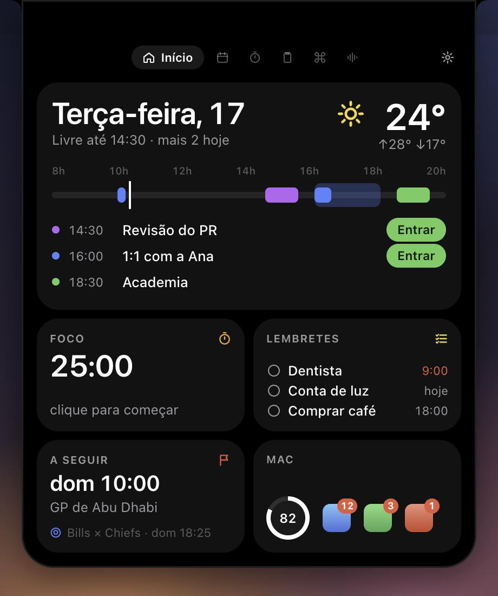
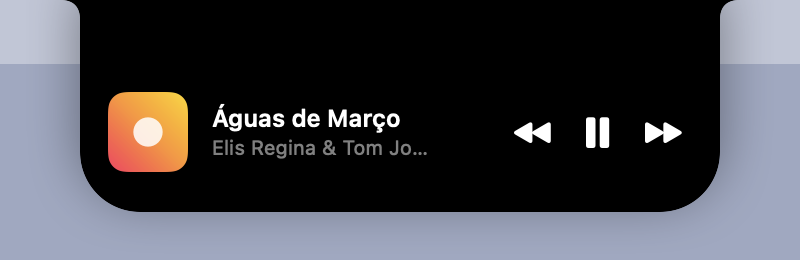
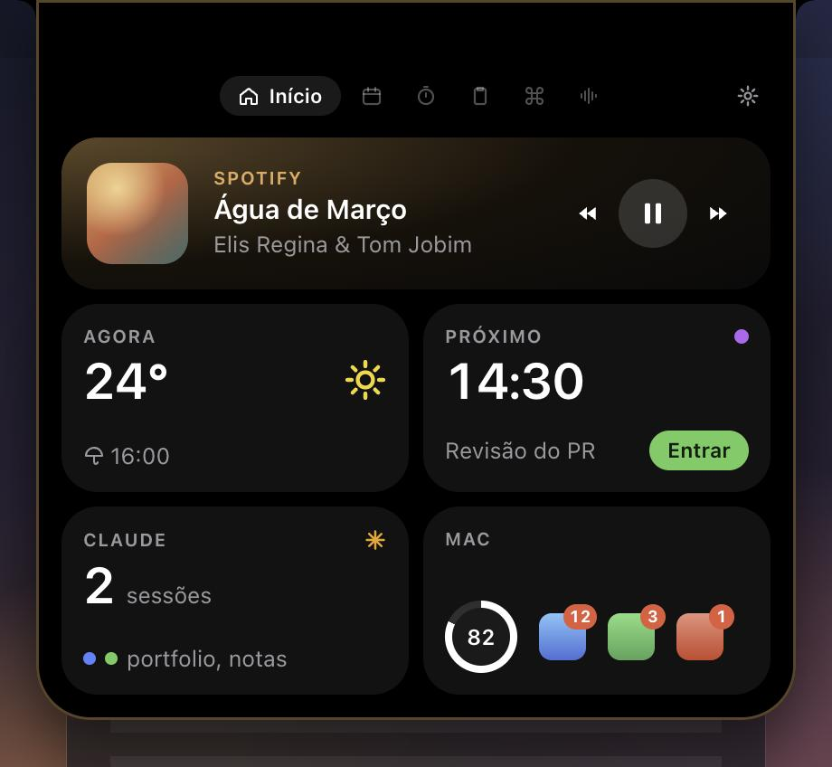
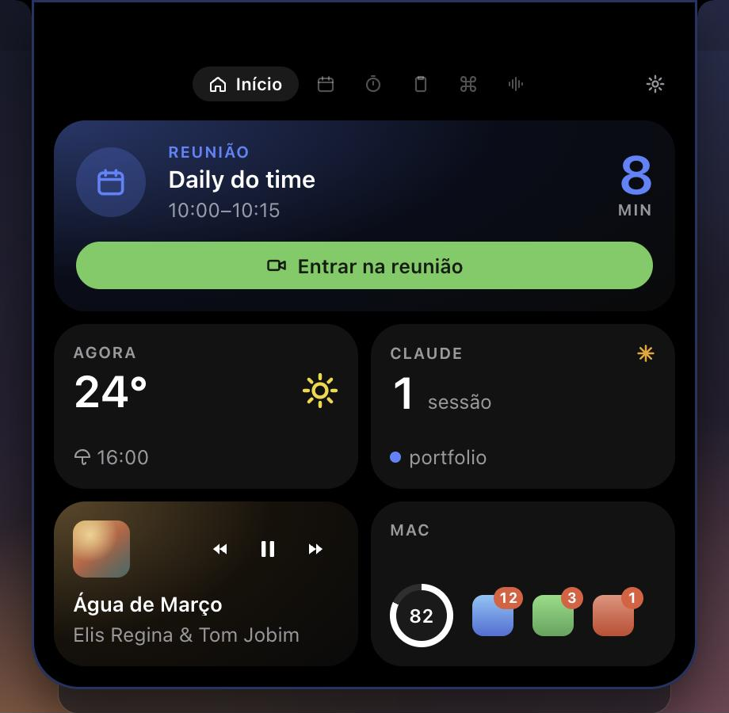
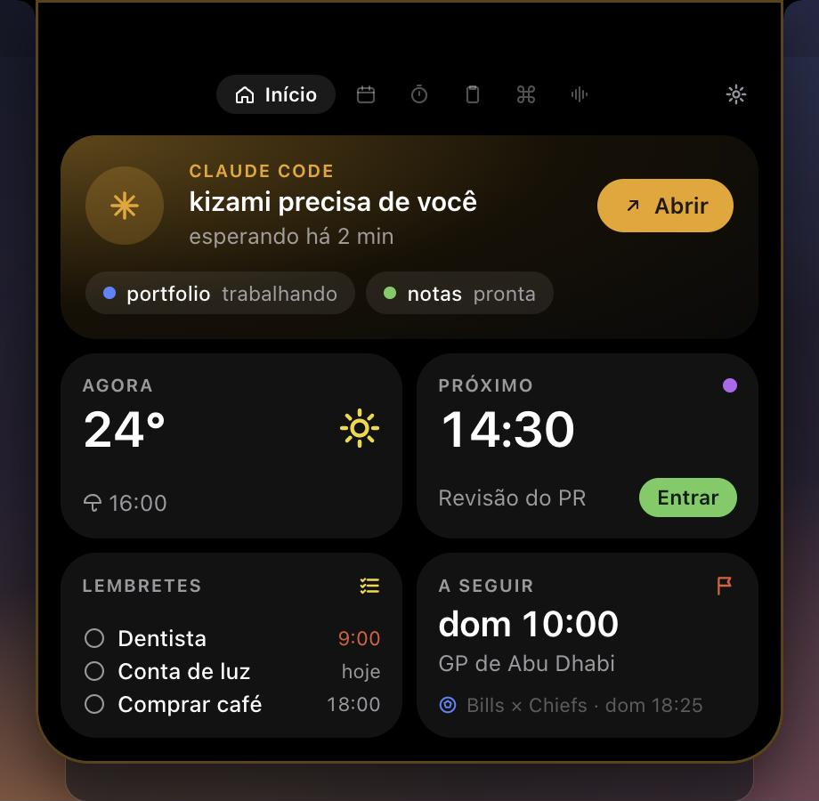

# Kizami

*[Leia em português](README.pt-BR.md)*

A small island around the MacBook notch that shows what other apps and scripts are doing: a finished build, a running transcription, an AI agent that needs you. Hover to see the list. It never takes focus from the app you are in.

*Kizami* (刻み) is Japanese for "notch". It comes from *kizamu*, to carve, and also to tick the time away.

| Closed | Something arrived | Hovered |
|---|---|---|
|  |  |  |

<sub>Closed and hovered: v0.16 design renders.</sub>

Free and open source (Apache 2.0). No private APIs and no third-party dependencies.

**Every permission is optional**, and each one turns on one thing:
- **Automation:** the artwork and media buttons of the song that is playing.
- **Calendars:** your next event.
- **Accessibility:** the Dock badges, the Shortcuts and Kanji tabs, browser play/pause and pasting from Copied.
- **Camera:** the mirror, only while it is open.
- **Downloads folder:** downloads in progress, if you turn them on.
- **Reminders:** today's reminders, if you turn them on.
- **Bluetooth:** the headphones-connected notice, if you turn it on.

**The network goes only to services that need no key:** Open-Meteo for the weather, ESPN's public schedules and scores for the games you follow, and the calendar links you paste in Settings. If you turn GitHub on, your own logged-in `gh` asks GitHub for your PRs; Kizami never sees the token. Audio, files and what you type never leave the Mac.

## Build

Only the Command Line Tools are needed (`xcode-select --install`), no Xcode.

```bash
make app       # build/Kizami.app
make install   # copies to /Applications and opens it
make teste     # tests for the pure rules
```

## Send an activity

The app's own binary is also the command line:

```bash
K=/Applications/Kizami.app/Contents/MacOS/Kizami
$K enviar --titulo "Build ready" --detalhe "12 s" --simbolo hammer --cor verde
$K enviar --titulo "Transcribing" --simbolo waveform --cor vermelho --id rec --expira 0
$K remover --id rec
$K limpar
```

- `--simbolo`: any SF Symbol name. A name that doesn't exist falls back to `bell.fill`.
- `--cor`: one of `vermelho`, `laranja`, `amarelo`, `verde`, `azul`, `roxo`, `rosa`, `cinza`.
- `--expira`: seconds until the activity disappears (default 10). `0` keeps it until `remover`.
- `--id`: sending again with the same id replaces the activity.
- `--prioridade`: `baixa`, `normal` (default), `alta` or `urgente`. The island sorts by it, and when it's full the least important activity leaves first. `baixa` joins the island without dropping it down.

From another app, post a distributed notification named `io.github.henriquebap.kizami.enviar`. Put the activity's JSON in `object`: `{"id", "titulo", "detalhe"?, "simbolo"?, "cor"?, "expira"?, "prioridade"?}`. Pass `deliverImmediately: true`: Kizami is never the active app, and without that flag macOS may hold the notification back.

**What arrives is data, never a command.** Any process on the Mac can post one. Kizami only displays it: cleaned of invisible and direction characters, length-limited and never parsed as Markdown. *Clear the Island*, in Kizami's menu bar item, removes everything.

## Now playing

When a player or browser is playing sound, the closed island shows its artwork (or the app's icon) and moving bars; hovered, it shows the title, the artist and the app. Title and artist come from the notifications Music and Spotify post on their own (no permission). The artwork is asked from the player through AppleScript: the first time, macOS asks whether Kizami may control Music or Spotify. Say no and the island shows the app's icon instead.

Hovered, Music and Spotify get **previous, play/pause and next** buttons, through the same Automation permission. A paused player stays on the island (with the play button) until it stops, quits or has been paused for 15 minutes. Browsers have no public media commands, so they show only the bars.

**Click the now-playing row** to expand it: large artwork, elapsed and remaining time, and a bar you drag to seek (Music and Spotify; browsers have no position). The position is read once a second, and only while it's expanded.



Only media apps count (players and browsers): Core Audio tells which apps have their audio output open, not whether anything audible is playing, and some apps keep it open in silence.



<sub>v0.16 design render.</sub>

## The open island

Hover the notch and the island opens. Closed, it stays black so it blends into the notch; open, it's darkened glass by default (**Settings… › Island › Background** goes from glass to solid black). At the top:
- **Home**: a two-column grid of widgets. The most important thing right now gets the full-width card on top: a Claude session waiting for you, then a meeting in the next 15 minutes, then the music (tinted with the album art's colour). With none of those, the calm day: the date and temperature large, "Free until 14:30", a 8 am–8 pm timeline with your events in their calendar colours and the hours rain is likely, and what's left today. Below it, the notices, then widgets in pairs (weather, next event, Claude sessions, music, timer, reminders, next game, Mac) and the tray. The open island's outline takes the colour of what's on top, and the artwork flies from the closed wing into its card.
- **Today**: the rest of the day's calendar, one event per line, with **Join** on the ones that have a meeting link.
- **Timer**: presets (Focus 25, Break 5, 10, 15, Focus 50). While it runs, the closed island shows the countdown around the notch. When a focus session ends, clicking the notice starts the 5-minute break, and the break's notice starts the next focus. No sound yet.
- **Copied** (off by default, Settings › Copied): the last 10 texts you copied, click one to paste it into the app you're in. They stay in memory only, never on disk, and vanish when Kizami quits; whatever password managers mark as concealed, and anything that looks like a key or token, is left out.
- **Shortcuts**: one click for the Mac's shortcuts, with the keys written under each one so you learn them: full screenshot (⇧⌘3), area (⇧⌘4), screenshot and recording (⇧⌘5), Mission Control, emoji (⌃⌘Space) and lock screen (⌃⌘Q). Sending keys needs the Accessibility permission, asked on the first click.
- **Kanji**: [Kanji](https://github.com/henriquebap/kanji-local-dictation), the dictation app, in one click: dictate, transcribe the Mac's audio, open Kanji, and one button per skill (dictate already rewritten as a LinkedIn reply, an informal message, a prompt…). They are Kanji's own shortcuts, read from its settings, so they change when you change them there. Same Accessibility permission as Shortcuts.
  The last button, **Mirror**, shows your camera in the island to check yourself before a call (asks for the camera; video only, never recorded, off as soon as the island closes).
- **⚙︎**: opens Settings (also in Kizami's menu bar item, or ⌘, with its menu open).

Only the chosen tab shows its name; the others show their icon (hover for the name).

| Meeting coming up | Claude needs you |
|---|---|
|  |  |

<sub>v0.16 design renders.</sub>

**Every day:**
- **Open at login:** Settings › General (macOS may ask you to approve it in Login Items).
- **Meeting coming up:** from 10 minutes before a meeting until 5 minutes after it starts, the closed island shows its countdown around the notch, in the calendar's colour.
- **Paused music:** click the play glyph in the closed wing to resume, without opening the island.
- **Volume:** when you change the volume, the closed island shows the level for 1.5 s (the system indicator still shows too).
- **The timer survives a restart:** a running or paused timer comes back when Kizami reopens. If it ended while Kizami was closed (less than an hour ago), you get the end notice.
- **Copied images:** Copied also keeps PNG and TIFF images (up to 10 MB each, 50 MB in all), in memory only, with a thumbnail.

**Make it yours** (Settings › Island tabs and below):
- **Tabs:** turn each tab on or off and change their order; the island opens on the first one. Home always stays.
- **Home:** hide the sections you don't want (next event and weather, interests, Claude sessions, now playing, apps and Mac, the file tray).
- **Closed island:** choose what comes first in the wings: the running timer, notices, the live score or the music. A meeting starting and Claude asking for permission always come first.
- **Timer:** the focus and break minutes, and up to 3 free timers.
- **Apple Shortcuts:** pick up to 6 shortcuts from the Shortcuts app; they become buttons in the Shortcuts tab, run with `shortcuts run`.

**Live score:** while a game of a team you follow is on, the closed island shows the score around the notch (away team on the left, home team on the right), refreshed every minute from ESPN, and the Interests row shows it with a red dot. Two games at once: the row shows both and the wings alternate every 8 s. At the end, a "Game over" notice with the final score; click it for the ESPN page. During a Formula 1 race you follow, the top 3 ("1 NOR · 2 VER · 3 HAD"), and at the end a notice with the podium.

**GitHub** (off by default, Settings › GitHub): a notice when CI fails on one of your open PRs or someone requests your review, through the `gh` you already have logged in, every 5 minutes, read only. Clicking opens the PR.

**Downloads** (off by default, Settings › Downloads): a file being downloaded in Chrome, Safari or Firefox shows with its size or percentage, then "Download complete"; click to show it in Finder. Asks for the Downloads folder.

**Reminders** (off by default, Settings › Reminders): up to 3 reminders from the Reminders app, overdue and today's first, then the ones without a date; click to mark one completed. Asks for Reminders.
**Headphones** (off by default, Settings › Headphones): when AirPods or other Bluetooth headphones connect, the island shows their name and battery for a few seconds (left, right and case, or the single battery). Asks for Bluetooth; Kizami only listens and never connects or disconnects anything.

**Urgent over full screen** (off by default, Settings › Full screen): during a full-screen video or game the island hides; with this on, it comes back only for a meeting starting or Claude asking for permission.

**Browser play/pause:** when a browser is playing (YouTube), the now-playing row gets a play/pause button. It sends the keyboard's play/pause key, which macOS hands to whoever is playing (Accessibility, like Shortcuts).

**Click an activity to open it:** a Claude alert brings its session forward, a game opens its ESPN page, a meeting reminder joins the call (or opens Calendar), a Dock badge opens the app. Activities sent by other apps or scripts only show.

## Today

The open island starts with a strip for the day:
- **Next event** from your calendars (EventKit), with a reminder 15 minutes before and when it starts. When the event has a Meet, Zoom, Teams, FaceTime or Whereby link, a **Join** button opens it. macOS asks for access to Calendars the first time; say no and the strip just leaves the event out.
- **Weather** for the city you type in **Settings… › Weather**, from [Open-Meteo](https://open-meteo.com) (no key, no account), refreshed every 15 minutes. When rain is coming in the next hour (Open-Meteo's 15-minute precipitation), a "Rain at 14:30" notice shows once per rain episode, and the weather chip shows an umbrella with the time. In Brazil that series is interpolated from the hourly forecast, so the time is approximate.

The weather chip shows today's date next to the temperature, in your Mac's language. **Click the calendar chip** to expand it: a week strip with a dot on each day that has events (or the whole month), and every event of the day you pick.

## Interests

Games and races you follow but don't keep in your calendar. In **Settings › Interests** (the ⚙︎ on the open island), pick a league and search a team (NFL, NBA, MLB, Brasileirão, Premier League, from ESPN's public schedules), turn on Formula 1, or paste an ICS / webcal calendar link. The island reminds you during the event's week, the day before and 1 hour before, and the open island shows the next one within 7 days. The Buffalo Bills come followed by default.

## Claude sessions

Claude Code hooks call `Kizami claude`, and the open island lists the running sessions: working, **needs you** (a permission prompt) or ready. A session that needs you also drops the island with an alert. Click a session to bring it forward: in Terminal and iTerm2, its own tab (macOS asks once for Automation; denied, the app comes forward); in VS Code and the Claude app, the app. Only the session id, the folder name and the state cross over, never your prompts or Claude's replies. Setup: [docs/CLAUDE-HOOKS.md](docs/CLAUDE-HOOKS.md).

The **needs you** notice always has an ✕. Once dismissed, it only comes back when the session changes state, and after 2 minutes it leaves the wings and stays in the open list.

## Apps and Mac

- **Microphone and camera in use:** an orange dot (mic) and a green dot (camera) on the closed island, like on the iPhone, and the app that is listening when you hover.
- **Battery:** the percentage when hovered, and a warning at 20% and 10%.
- **Unread counts from the Dock** (WhatsApp 3, Mail 12): turn them on in **Settings… › Apps and Mac**. Reading the Dock needs the Accessibility permission. When a count goes up, the island drops a line; click an app to open it. macOS has no way to read other apps' notification text, only these counts.

## File tray

Drag files from any app to the notch: the island opens with *Drop here to keep*. The files stay in a row on the island so you can drag them into another app later, AirDrop them, or empty the tray. Double-click opens a file; right-click shows it in Finder or removes it. The tray keeps a reference, not a copy: dragging a file out works like dragging it from Finder, and the tray is emptied when Kizami quits.


## Behavior

- **Notch:** on a screen with a notch, the island hugs it and opens when the cursor touches the notch itself, never the menus beside it. On a screen without one, the island is just the two "wings" under the menu bar.
- **Monitors:** one island on every display, so you see it on the screen you are working on. They are rebuilt when displays change.
- **New activity:** the island drops a line below the notch with the title for a few seconds, then closes again. Up to three that arrive together drop at once, the most important on top; closed, the island shows up to three icons.
- **On launch:** it shows "Kizami is running", and the menu bar item says how many activities are on the island.
- **Full screen:** it hides on a display that is in full screen, so it never sits over a video, game or presentation.
- **Always there:** with nothing to show, the island rests as a small pill around the notch (or at the top of a display without one). Hovered, it offers the empty tray.
- **Clicks:** while closed, clicks pass through to the menu bar.

## License

[Apache 2.0](LICENSE). The **Kizami** name and icon are not covered by the license (see [NOTICE](NOTICE)).
