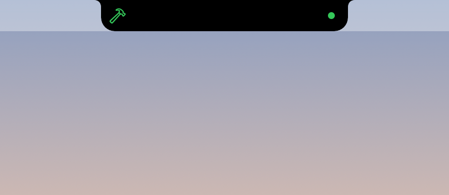
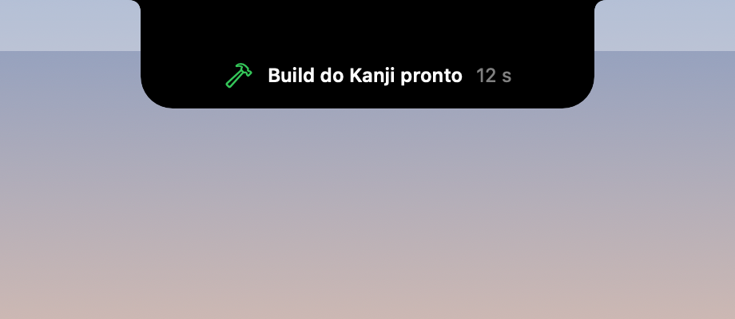
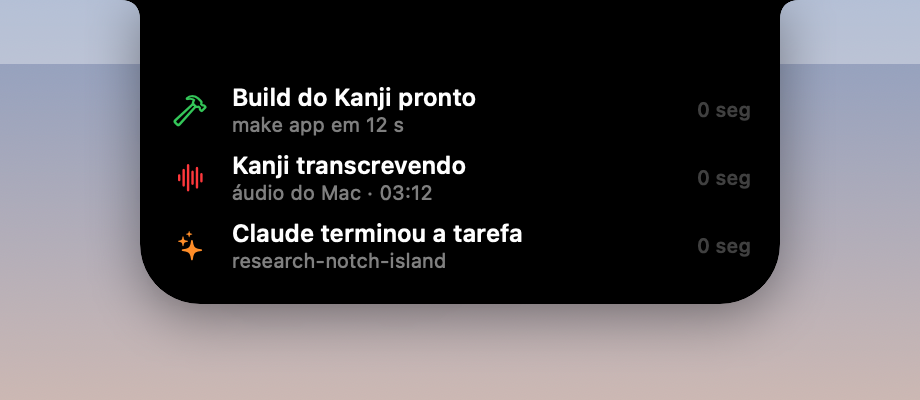

# Kizami

*[Leia em português](README.pt-BR.md)*

A small island around the MacBook notch that shows what other apps and scripts are doing: a finished build, a running transcription, an AI agent that needs you. Hover to see the list. It never takes focus from the app you are in.

*Kizami* (刻み) is Japanese for "notch". It comes from *kizamu*, to carve, and also to tick the time away.

| Closed | Something arrived | Hovered |
|---|---|---|
|  |  |  |

Free and open source (Apache 2.0). No private APIs and no permissions. No third-party dependencies.

## Build

Only the Command Line Tools are needed (`xcode-select --install`), no Xcode.

```bash
make app       # build/Kizami.app
make install   # copies to /Applications and opens it
make teste     # tests for the pure rules
```

## Send an activity

The app's own binary is also the command line:

```bash
K=/Applications/Kizami.app/Contents/MacOS/Kizami
$K enviar --titulo "Build ready" --detalhe "12 s" --simbolo hammer --cor verde
$K enviar --titulo "Transcribing" --simbolo waveform --cor vermelho --id rec --expira 0
$K remover --id rec
$K limpar
```

- `--simbolo`: any SF Symbol name. A name that doesn't exist falls back to `bell.fill`.
- `--cor`: one of `vermelho`, `laranja`, `amarelo`, `verde`, `azul`, `roxo`, `rosa`, `cinza`.
- `--expira`: seconds until the activity disappears (default 10). `0` keeps it until `remover`.
- `--id`: sending again with the same id replaces the activity.

From another app, post a distributed notification named `io.github.henriquebap.kizami.enviar`. Put the activity's JSON in `object`: `{"id", "titulo", "detalhe"?, "simbolo"?, "cor"?, "expira"?}`. Pass `deliverImmediately: true`: Kizami is never the active app, and without that flag macOS may hold the notification back.

**What arrives is data, never a command.** Any process on the Mac can post one. Kizami only displays it: cleaned of invisible and direction characters, length-limited and never parsed as Markdown. *Clear the Island*, in Kizami's menu bar item, removes everything.

## Behavior

- **Notch:** on a screen with a notch, the island hugs it and opens when the cursor touches the notch itself, never the menus beside it. On a screen without one, the island is just the two "wings" under the menu bar.
- **Monitors:** one island on every display, so you see it on the screen you are working on. They are rebuilt when displays change.
- **New activity:** the island drops a line below the notch with the title for a few seconds, then closes again.
- **On launch:** it shows "Kizami is running", and the menu bar item says how many activities are on the island.
- **Full screen:** it shows on top of full-screen apps.
- **No activity:** the island shrinks back into the notch.
- **Clicks:** while closed, clicks pass through to the menu bar.

## License

[Apache 2.0](LICENSE). The **Kizami** name and icon are not covered by the license (see [NOTICE](NOTICE)).
