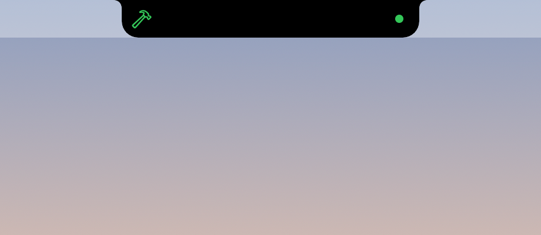
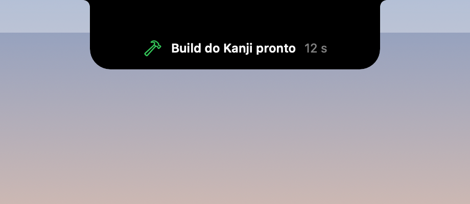
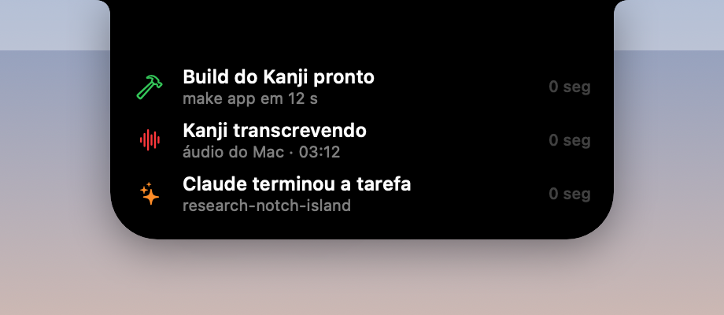
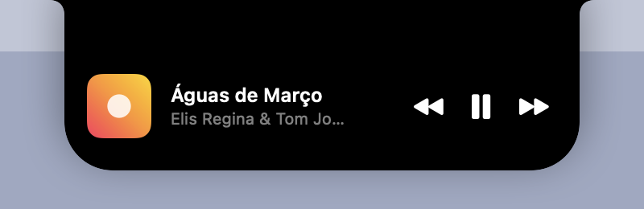
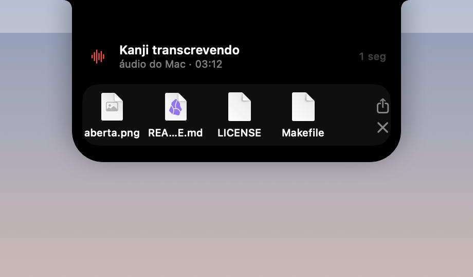

# Kizami

*[Read in English](README.md)*

Uma pequena ilha em volta do notch do MacBook que mostra o que outros apps e scripts estão fazendo: um build que terminou, uma transcrição rodando, um agente de IA esperando por você. Passe o mouse para ver a lista. O Kizami nunca rouba o foco do app em que você está.

*Kizami* (刻み) é "entalhe" em japonês, o nome do notch. Vem de *kizamu*, que é entalhar e também marcar o tempo que passa.

| Fechada | Chegou uma atividade | Com o mouse em cima |
|---|---|---|
|  |  |  |

Gratuito e open source (Apache 2.0). Não usa API privada nem tem dependências de terceiros. A única permissão é opcional: Automação, para mostrar a capa da música que está tocando.

## Compilar

Só precisa das Command Line Tools (`xcode-select --install`), sem Xcode.

```bash
make app       # build/Kizami.app
make install   # copia para /Applications e abre
make teste     # testes das regras puras
```

## Enviar uma atividade

O próprio binário do app também é a linha de comando:

```bash
K=/Applications/Kizami.app/Contents/MacOS/Kizami
$K enviar --titulo "Build pronto" --detalhe "12 s" --simbolo hammer --cor verde
$K enviar --titulo "Transcrevendo" --simbolo waveform --cor vermelho --id rec --expira 0
$K remover --id rec
$K limpar
```

- `--simbolo`: o nome de qualquer SF Symbol. Um nome que não existe vira `bell.fill`.
- `--cor`: uma de `vermelho`, `laranja`, `amarelo`, `verde`, `azul`, `roxo`, `rosa`, `cinza`.
- `--expira`: segundos até a atividade sumir (padrão: 10). `0` deixa na ilha até o `remover`.
- `--id`: enviar de novo com o mesmo id substitui a atividade.

De outro app, poste uma notificação distribuída com o nome `io.github.henriquebap.kizami.enviar`. O JSON da atividade vai em `object`: `{"id", "titulo", "detalhe"?, "simbolo"?, "cor"?, "expira"?}`. Passe `deliverImmediately: true`: o Kizami nunca é o app ativo, e sem esse parâmetro o macOS pode segurar a notificação.

**O que chega é dado, nunca comando.** Qualquer processo do Mac pode enviar. O Kizami só exibe: tira os caracteres invisíveis e de direção, limita o tamanho e nunca interpreta Markdown. *Limpar a ilha*, no item do Kizami na barra de menus, tira tudo.

## Tocando agora

Quando um player ou navegador está tocando som, a ilha fechada mostra a capa (ou o ícone do app) e barras animadas; com o mouse em cima, mostra o título, o artista e o app. Título e artista vêm das notificações que o Music e o Spotify publicam sozinhos (sem permissão). A capa é pedida ao player por AppleScript: na primeira vez, o macOS pergunta se o Kizami pode controlar o Music ou o Spotify. Negando, a ilha mostra o ícone do app.

Com o mouse em cima, o Music e o Spotify ganham os botões **anterior, tocar/pausar e próxima**, pela mesma permissão de Automação. Um player pausado continua na ilha (com o botão de tocar) até parar, fechar ou ficar 15 minutos em pausa. Navegadores não têm comando de mídia público, então mostram só as barras.



Só apps de mídia contam (players e navegadores): o Core Audio diz quais apps estão com a saída de áudio aberta, não se algo audível está tocando, e alguns apps mantêm a saída aberta em silêncio.


## Bandeja de arquivos

Arraste arquivos de qualquer app até o notch: a ilha abre com *Solte aqui para guardar*. Os arquivos ficam numa fileira na ilha para você arrastar depois para outro app, mandar por AirDrop ou esvaziar a bandeja. Clique duplo abre o arquivo; o botão direito mostra no Finder ou tira da bandeja. A bandeja guarda o endereço, não uma cópia: arrastar para fora funciona como arrastar do Finder, e a bandeja esvazia quando o Kizami fecha.



## Comportamento

- **Notch:** na tela com notch, a ilha abraça o notch e abre quando o cursor toca o próprio notch, nunca os menus ao lado. Em tela sem notch, a ilha é só as duas "asas", sob a barra de menus.
- **Monitores:** uma ilha em cada monitor, para você ver na tela em que está trabalhando. Elas são recriadas quando os monitores mudam.
- **Atividade nova:** a ilha desce uma linha abaixo do notch com o título por alguns segundos e depois volta a fechar.
- **Ao abrir:** mostra "Kizami está rodando", e o item na barra de menus diz quantas atividades há na ilha.
- **Tela cheia:** a ilha aparece por cima de apps em tela cheia.
- **Sempre lá:** sem nada para mostrar, a ilha fica em repouso, uma pílula pequena em volta do notch (ou no topo de uma tela sem notch). Com o mouse em cima, oferece a bandeja vazia.
- **Cliques:** fechada, ela deixa os cliques passarem para a barra de menus.

## Licença

[Apache 2.0](LICENSE). O nome **Kizami** e o ícone não fazem parte da licença (veja o [NOTICE](NOTICE)).
