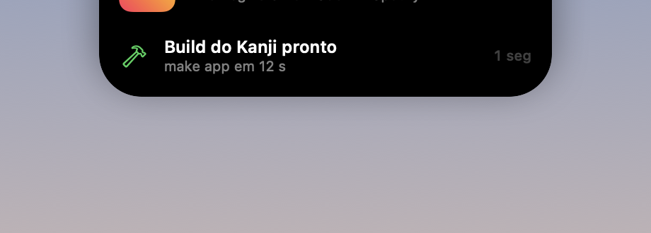

# Kizami

*[Read in English](README.md)*

Uma pequena ilha em volta do notch do MacBook que mostra o que outros apps e scripts estão fazendo: um build que terminou, uma transcrição rodando, um agente de IA esperando por você. Passe o mouse para ver a lista. O Kizami nunca rouba o foco do app em que você está.

*Kizami* (刻み) é "entalhe" em japonês, o nome do notch. Vem de *kizamu*, que é entalhar e também marcar o tempo que passa.

| Fechada | Chegou uma atividade | Com o mouse em cima |
|---|---|---|
|  |  |  |

Gratuito e open source (Apache 2.0). Não usa API privada nem tem dependências de terceiros.

**Toda permissão é opcional**, e cada uma liga uma coisa:
- **Automação:** a capa e os botões da música que está tocando.
- **Calendários:** o seu próximo evento.
- **Acessibilidade:** os emblemas do Dock, as abas Atalhos e Kanji, o play/pause do navegador e colar dos Copiados.
- **Câmera:** o espelho, só enquanto está aberto.
- **Pasta Downloads:** os downloads em andamento, se você ligar.

**A rede só vai a serviços que não pedem chave:** Open-Meteo para o tempo, as agendas e placares públicos da ESPN para os jogos que você segue, e os links de calendário que você cola nos Ajustes. Se você ligar o GitHub, o seu próprio `gh` logado pede ao GitHub os seus PRs; o Kizami nunca vê o token. Áudio, arquivos e o que você digita nunca saem do Mac.

## Compilar

Só precisa das Command Line Tools (`xcode-select --install`), sem Xcode.

```bash
make app       # build/Kizami.app
make install   # copia para /Applications e abre
make teste     # testes das regras puras
```

## Enviar uma atividade

O próprio binário do app também é a linha de comando:

```bash
K=/Applications/Kizami.app/Contents/MacOS/Kizami
$K enviar --titulo "Build pronto" --detalhe "12 s" --simbolo hammer --cor verde
$K enviar --titulo "Transcrevendo" --simbolo waveform --cor vermelho --id rec --expira 0
$K remover --id rec
$K limpar
```

- `--simbolo`: o nome de qualquer SF Symbol. Um nome que não existe vira `bell.fill`.
- `--cor`: uma de `vermelho`, `laranja`, `amarelo`, `verde`, `azul`, `roxo`, `rosa`, `cinza`.
- `--expira`: segundos até a atividade sumir (padrão: 10). `0` deixa na ilha até o `remover`.
- `--id`: enviar de novo com o mesmo id substitui a atividade.
- `--prioridade`: `baixa`, `normal` (padrão), `alta` ou `urgente`. A ilha ordena por ela, e cheia, sai primeiro a menos importante. `baixa` entra na ilha sem fazer ela descer.

De outro app, poste uma notificação distribuída com o nome `io.github.henriquebap.kizami.enviar`. O JSON da atividade vai em `object`: `{"id", "titulo", "detalhe"?, "simbolo"?, "cor"?, "expira"?, "prioridade"?}`. Passe `deliverImmediately: true`: o Kizami nunca é o app ativo, e sem esse parâmetro o macOS pode segurar a notificação.

**O que chega é dado, nunca comando.** Qualquer processo do Mac pode enviar. O Kizami só exibe: tira os caracteres invisíveis e de direção, limita o tamanho e nunca interpreta Markdown. *Limpar a ilha*, no item do Kizami na barra de menus, tira tudo.

## Tocando agora

Quando um player ou navegador está tocando som, a ilha fechada mostra a capa (ou o ícone do app) e barras animadas; com o mouse em cima, mostra o título, o artista e o app. Título e artista vêm das notificações que o Music e o Spotify publicam sozinhos (sem permissão). A capa é pedida ao player por AppleScript: na primeira vez, o macOS pergunta se o Kizami pode controlar o Music ou o Spotify. Negando, a ilha mostra o ícone do app.

Com o mouse em cima, o Music e o Spotify ganham os botões **anterior, tocar/pausar e próxima**, pela mesma permissão de Automação. Um player pausado continua na ilha (com o botão de tocar) até parar, fechar ou ficar 15 minutos em pausa. Navegadores não têm comando de mídia público, então mostram só as barras.

**Clique na linha do tocando agora** para expandir: capa grande, tempo decorrido e restante, e uma barra que você arrasta para pular (Music e Spotify; navegador não tem posição). A posição é lida uma vez por segundo, e só enquanto está expandida.


Só apps de mídia contam (players e navegadores): o Core Audio diz quais apps estão com a saída de áudio aberta, não se algo audível está tocando, e alguns apps mantêm a saída aberta em silêncio.



## A ilha aberta

Passe o mouse no notch e a ilha abre. A ilha continua preta, para se fundir ao notch; os cartões, chips e botões de dentro são Liquid Glass, e um item que você expande cresce a partir do chip dele. No topo:
- **Início**: tudo o que está abaixo (hoje, interesses, sessões do Claude, tocando agora, atividades, apps, bandeja).
- **Hoje**: o resto da agenda do dia, um evento por linha, com **Entrar** nos que têm link de reunião.
- **Timer**: atalhos prontos (Foco 25, Pausa 5, 10, 15, Foco 50). Enquanto corre, a ilha fechada mostra a contagem em volta do notch. No fim de um foco, clicar no aviso começa a pausa de 5 minutos, e o aviso da pausa começa o próximo foco. Ainda sem som.
- **Copiados** (desligado por padrão, Ajustes › Copiados): os últimos 10 textos que você copiou; clique num para colar no app em que você está. Ficam só na memória, nunca em disco, e somem ao fechar o Kizami; o que os gerenciadores de senha marcam como oculto, e o que parece chave ou token, fica de fora.
- **Atalhos**: os atalhos do Mac num clique, com as teclas escritas embaixo de cada um para você ir aprendendo: captura da tela (⇧⌘3), de uma área (⇧⌘4), captura e gravação (⇧⌘5), Mission Control, emojis (⌃⌘Espaço) e bloquear a tela (⌃⌘Q). Mandar teclas pede a permissão de Acessibilidade, pedida no primeiro clique.
- **Kanji**: o [Kanji](https://github.com/henriquebap/kanji-local-dictation), o app de ditado, num clique: ditar, transcrever o áudio do Mac, abrir o Kanji e um botão por skill (ditar já reescrevendo como resposta de LinkedIn, mensagem informal, prompt…). São os próprios atalhos do Kanji, lidos dos ajustes dele, então mudam quando você muda lá. A mesma permissão de Acessibilidade dos Atalhos.
  O último botão, **Espelho**, mostra a câmera na ilha para você se ver antes de uma chamada (pede a câmera; só vídeo, nunca gravado, desligado assim que a ilha fecha).
- **⚙︎**: abre os Ajustes (também no item do Kizami na barra de menus, ou ⌘, com o menu aberto).

Só a aba escolhida mostra o nome; as outras mostram o ícone (o nome aparece com o cursor em cima).

**No dia a dia:**
- **Abrir no login:** Ajustes › Geral (o macOS pode pedir para você aprovar em Itens de Início).
- **Reunião chegando:** de 10 minutos antes até 5 minutos depois de uma reunião começar, a ilha fechada mostra a contagem em volta do notch.
- **O timer sobrevive ao reinício:** um timer correndo ou pausado volta quando o Kizami reabre. Se acabou com o Kizami fechado (há menos de uma hora), chega o aviso de fim.
- **Imagens nos Copiados:** os Copiados guardam também imagens PNG e TIFF (até 10 MB cada, 50 MB no total), só na memória, com miniatura.

**Do seu jeito** (Ajustes › Abas da ilha e abaixo):
- **Abas:** ligue ou desligue cada aba e mude a ordem; a ilha abre na primeira. O Início fica sempre.
- **Início:** esconda as seções que você não quer (próximo evento e tempo, interesses, sessões do Claude, tocando agora, apps e Mac, a bandeja).
- **Ilha fechada:** escolha o que tem a vez nas asas: o timer correndo, os avisos, o placar ao vivo ou a música. Reunião começando e o Claude pedindo permissão vêm sempre primeiro.
- **Timer:** os minutos do foco e da pausa, e até 3 timers livres.
- **Atalhos da Apple:** escolha até 6 atalhos do app Atalhos; eles viram botões na aba Atalhos e rodam com `shortcuts run`.

**Placar ao vivo:** durante um jogo de um time que você segue, a ilha fechada mostra o placar em volta do notch (visitante à esquerda, mandante à direita), atualizado a cada minuto pela ESPN, e a linha dos Interesses mostra o placar com um ponto vermelho. Dois jogos ao mesmo tempo: a linha mostra os dois e as asas alternam a cada 8 s. No fim, um aviso "Fim de jogo" com o placar final; o clique abre a página da ESPN. Numa corrida de Fórmula 1 que você segue, os 3 primeiros ("1 NOR · 2 VER · 3 HAD"), e no fim um aviso com o pódio.

**GitHub** (desligado por padrão, Ajustes › GitHub): um aviso quando a CI falha num PR seu aberto ou pedem a sua revisão, pelo `gh` que você já tem logado, a cada 5 minutos, só leitura. O clique abre o PR.

**Downloads** (desligado por padrão, Ajustes › Downloads): um arquivo sendo baixado no Chrome, Safari ou Firefox aparece com o tamanho ou a porcentagem, depois "Download concluído"; o clique mostra o arquivo no Finder. Pede a pasta Downloads.

**Urgente por cima da tela cheia** (desligado por padrão, Ajustes › Tela cheia): em vídeo ou jogo em tela cheia a ilha some; ligado, ela volta só para a reunião começando ou o Claude pedindo permissão.

**Play/pause do navegador:** quando um navegador está tocando (YouTube), a linha do que está tocando ganha um botão de tocar ou pausar. Ele manda a tecla de play/pause do teclado, que o macOS entrega a quem está tocando (Acessibilidade, como os Atalhos).

**Clique numa atividade para abrir:** o aviso do Claude traz a sessão para a frente, um jogo abre a página dele na ESPN, o lembrete de reunião entra na chamada (ou abre o Calendário), um emblema do Dock abre o app. As atividades mandadas por outros apps ou scripts só aparecem.

## Hoje

A ilha aberta começa com uma faixa do dia:
- **Próximo evento** dos seus calendários (EventKit), com aviso 15 minutos antes e na hora de começar. Quando o evento tem link de Meet, Zoom, Teams, FaceTime ou Whereby, o botão **Entrar** abre a reunião. Na primeira vez o macOS pede acesso aos Calendários; negado, a faixa só deixa o evento de fora.
- **Tempo** da cidade que você digita em **Ajustes… › Tempo**, do [Open-Meteo](https://open-meteo.com) (sem chave nem conta), atualizado a cada 15 minutos. Quando vem chuva na próxima hora (a precipitação de 15 em 15 minutos do Open-Meteo), um aviso "Chuva às 14:30" aparece uma vez por chuva, e o chip do tempo mostra um guarda-chuva com a hora. No Brasil essa série é interpolada da previsão de hora em hora, então a hora é aproximada.

O chip do tempo mostra a data de hoje ao lado da temperatura, no idioma do Mac. **Clique no chip da agenda** para expandir: uma faixa da semana com um ponto em cada dia que tem evento (ou o mês inteiro), e todos os eventos do dia que você escolher.

## Interesses

Jogos e corridas que você acompanha mas não tem no calendário. Em **Ajustes › Interesses** (a ⚙︎ na ilha aberta), escolha a liga e busque o time (NFL, NBA, MLB, Brasileirão, Premier League, das agendas públicas da ESPN), ligue a Fórmula 1 ou cole o link de um calendário ICS / webcal. A ilha lembra na semana do evento, na véspera e 1 hora antes, e a ilha aberta mostra o próximo nos 7 dias seguintes. O Buffalo Bills já vem seguido.

## Sessões do Claude

Os hooks do Claude Code chamam `Kizami claude`, e a ilha aberta lista as sessões rodando: trabalhando, **precisa de você** (um pedido de permissão) ou pronta. Uma sessão que precisa de você também faz a ilha descer com um aviso. Clicar numa sessão traz ela para a frente: no Terminal e no iTerm2, a própria aba (o macOS pede Automação uma vez; negada, vem o app); no VS Code e no app do Claude, o app. Só passam o id da sessão, o nome da pasta e o estado, nunca os seus pedidos nem as respostas do Claude. Como ligar: [docs/CLAUDE-HOOKS.md](docs/CLAUDE-HOOKS.md).

O aviso **precisa de você** tem sempre um ✕. Dispensado, ele só volta quando a sessão muda de estado, e depois de 2 minutos ele sai das asas e fica na lista da ilha aberta.

## Apps e Mac

- **Microfone e câmera em uso:** um ponto laranja (microfone) e um verde (câmera) na ilha fechada, como no iPhone, e o app que está ouvindo com o mouse em cima.
- **Bateria:** a porcentagem com o mouse em cima, e um aviso em 20% e 10%.
- **Mensagens não lidas do Dock** (WhatsApp 3, Mail 12): ligue em **Ajustes… › Apps e Mac**. Ler o Dock pede a permissão de Acessibilidade. Quando um número sobe, a ilha desce uma linha; clicar num app abre o app. O macOS não deixa ler o texto das notificações de outros apps, só esses números.

## Bandeja de arquivos

Arraste arquivos de qualquer app até o notch: a ilha abre com *Solte aqui para guardar*. Os arquivos ficam numa fileira na ilha para você arrastar depois para outro app, mandar por AirDrop ou esvaziar a bandeja. Clique duplo abre o arquivo; o botão direito mostra no Finder ou tira da bandeja. A bandeja guarda o endereço, não uma cópia: arrastar para fora funciona como arrastar do Finder, e a bandeja esvazia quando o Kizami fecha.


## Comportamento

- **Notch:** na tela com notch, a ilha abraça o notch e abre quando o cursor toca o próprio notch, nunca os menus ao lado. Em tela sem notch, a ilha é só as duas "asas", sob a barra de menus.
- **Monitores:** uma ilha em cada monitor, para você ver na tela em que está trabalhando. Elas são recriadas quando os monitores mudam.
- **Atividade nova:** a ilha desce uma linha abaixo do notch com o título por alguns segundos e depois volta a fechar. Até três que chegam juntas descem de uma vez, a mais importante em cima; fechada, a ilha mostra até três ícones.
- **Ao abrir:** mostra "Kizami está rodando", e o item na barra de menus diz quantas atividades há na ilha.
- **Tela cheia:** a ilha some no monitor que está em tela cheia, para nunca ficar por cima de um vídeo, jogo ou apresentação.
- **Sempre lá:** sem nada para mostrar, a ilha fica em repouso, uma pílula pequena em volta do notch (ou no topo de uma tela sem notch). Com o mouse em cima, oferece a bandeja vazia.
- **Cliques:** fechada, ela deixa os cliques passarem para a barra de menus.

## Licença

[Apache 2.0](LICENSE). O nome **Kizami** e o ícone não fazem parte da licença (veja o [NOTICE](NOTICE)).
